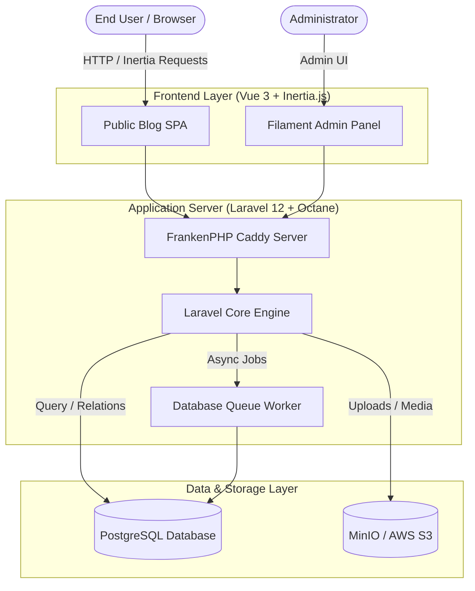

# Cyber Blog Platform

A modern, high-performance blog and publishing application built with **Laravel 12**, **Laravel Octane (FrankenPHP)**, **Inertia.js**, **Vue 3**, and **Filament Admin**.

---

## 🚀 Key Capabilities

- **⚡ Blazing Fast Runtime**: Powered by **Laravel Octane** with **FrankenPHP** worker mode for low-latency request handling.
- **🎨 Modern Single-Page Experience**: **Inertia.js** paired with **Vue 3** and **Tailwind CSS** delivers a seamless SPA feel without building a decoupled REST client.
- **🛠️ Administrative CMS**: Full-featured **Filament** admin dashboard for managing articles, categories, and media.
- **🔐 Dual Authentication**: JWT-based session security with refresh tokens alongside **Google Socialite OAuth** integration.
- **💬 Interactive Community Features**:
  - Infinite scroll feed for posts and nested comments/replies.
  - Real-time like counter and bookmarking (Saved Posts).
- **📦 S3/MinIO Object Storage**: Seamless media asset handling with AWS S3 and self-hosted MinIO compatibility.
- **🐳 Containerized Multi-Stage Builds**: Production-ready `Dockerfile` bundling frontend assets and FrankenPHP runtime.

---

## 🏗️ Architecture Overview



---

## 🛠️ Tech Stack

| Layer | Technology |
|---|---|
| **Backend Framework** | Laravel 12.x (PHP 8.3+) |
| **App Server / Engine** | Laravel Octane + FrankenPHP |
| **Admin Panel** | Filament 3.x / 4.x |
| **Frontend Stack** | Inertia.js 2.x, Vue 3, Tailwind CSS, Flowbite |
| **Database** | PostgreSQL |
| **File Storage** | MinIO / AWS S3 (via Flysystem) |
| **Auth** | JWT (Firebase JWT) + Google Socialite |
| **Bundler** | Vite |

---

## 📋 Prerequisites

Ensure you have the following installed on your system:

- **PHP** >= 8.2 (PHP 8.3 recommended) with extensions: `pdo_pgsql`, `mbstring`, `gd`, `intl`, `zip`, `pcntl`
- **Composer** >= 2.x
- **Node.js** >= 20.x & **npm**
- **PostgreSQL** Server (running on port `5432` by default)
- *(Optional)* **Docker** & Docker Compose (for MinIO / Containerized run)

---

## ⚡ Quickstart / Local Setup

### 1. Clone & Navigate
```bash
git clone <repository-url>
cd blog-laravel
```

### 2. Install Dependencies
```bash
composer install
npm install
```

### 3. Configure Environment
```bash
cp .env.example .env
php artisan key:generate
```

### 4. Database Setup & Migrations
Ensure your PostgreSQL database exists, then run:
```bash
php artisan migrate --seed
php artisan storage:link
```

### 5. Create Filament Admin User
```bash
php artisan make:filament-user
```

### 6. Run the Application

#### Option A: Concurrent Dev Server (Recommended)
Runs backend server, queue listener, log viewer (Pail), and Vite simultaneously:
```bash
composer run dev
```

#### Option B: Octane with FrankenPHP
```bash
# Terminal 1: Octane Backend
php artisan octane:start --server=frankenphp

# Terminal 2: Frontend Assets Watcher
npm run dev
```

The application will be accessible at:
- **Web App**: `http://localhost:8000`
- **Admin Panel**: `http://localhost:8000/admin`

---

## 🔑 Environment Variables

Key configuration variables located in `.env`:

| Variable | Description | Default / Example | Required |
|---|---|---|---|
| `APP_ENV` | Application environment | `local` | Yes |
| `APP_KEY` | Laravel encryption key | `base64:...` | Yes |
| `DB_CONNECTION` | Database driver | `pgsql` | Yes |
| `DB_HOST` | Database host | `127.0.0.1` | Yes |
| `DB_PORT` | Database port | `5432` | Yes |
| `DB_DATABASE` | Database name | `filament` | Yes |
| `DB_USERNAME` | Database username | `postgres` | Yes |
| `DB_PASSWORD` | Database password | `secret` | Yes |
| `FILESYSTEM_DISK` | Default storage driver | `minio` | Yes |
| `MINIO_ENDPOINT` | Object storage API endpoint | `http://127.0.0.1:9000` | Optional |
| `MINIO_BUCKET` | Storage bucket name | `project` | Optional |
| `GOOGLE_CLIENT_ID` | Google OAuth Client ID | - | Optional |
| `GOOGLE_CLIENT_SECRET` | Google OAuth Secret | - | Optional |

---

## 🐳 Docker Deployment

To build and run the complete application inside a production-ready FrankenPHP container:

```bash
# Build the Docker image
docker build -t laravel-frankenphp .

# Run the container
docker run --rm -it -p 8080:8000 --env-file .env laravel-frankenphp
```

Access the containerized instance at `http://localhost:8080`.

---

## 🧪 Testing & Code Quality

Run tests and code formatting checks:

```bash
# Run Pest PHP test suite
./vendor/bin/pest

# Run Laravel Pint code formatter
./vendor/bin/pint
```

---

## 📄 License

This project is open-sourced software licensed under the [MIT license](LICENSE).
